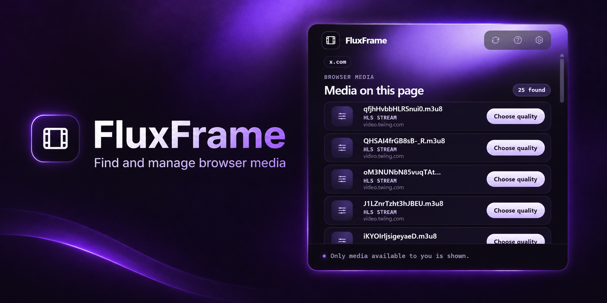

# FluxFrame

A Chrome extension that finds direct video files and supported HLS streams on the page you are viewing, then downloads them through Chrome.



## Features

- Detects media from `<video>`/`<source>` elements and from network response headers.
- Lists each item with its source, format, and known file size.
- Downloads direct media files through Chrome's download manager.
- Offers quality selection for HLS master playlists, plus separate audio renditions.
- Local ignored-domain list and a recent-download list (up to 30 entries).
- Refuses DRM-protected streams and unsupported HLS features instead of producing broken files.
- Dark navy interface with violet accents.

## Getting started

Requirements: Google Chrome (Manifest V3). Node.js is only needed to run the tests.

1. Clone this repository.
2. Open `chrome://extensions` and enable **Developer mode**.
3. Click **Load unpacked** and select the repository folder (the one containing `manifest.json`).
4. Pin FluxFrame, open a page with supported media, and click the extension icon.

> If you downloaded a release zip instead of cloning, extract it first — Chrome can't load a zip directly with **Load unpacked**.

## Permissions

| Permission | Why it is needed |
|---|---|
| `webRequest` | Observe request URLs and response headers to identify direct video files and HLS playlists. |
| `<all_urls>` host access | Media is often served from CDN hosts different from the page, so detection must work across arbitrary sites. A content script also reads video and source URLs on the page. |
| `downloads` | Start direct downloads and record their local status. |
| `storage` | Save ignored domains and the recent-download list in `chrome.storage.local`. |

You can restrict site access at any time from Chrome's extension controls.

## Privacy

Detection runs in the browser. Candidate media URLs are held temporarily in service-worker memory (30-minute expiry) and are never written to storage or sent anywhere by FluxFrame. There is no account, analytics, or developer-operated server. See [PRIVACY.md](PRIVACY.md).

## HLS support and limitations

Supported: ordinary HLS media playlists, master-playlist quality selection, separate audio renditions, and identity AES-128 segment encryption. HLS downloads are assembled in memory and capped at 300 MB. Keep the downloader tab open until it finishes.

Not supported: DRM, other encryption methods, byte-range segments, discontinuities, I-frame-only playlists, DASH, and fragmented MP4 without its initialization segment. Live playlists download only the snapshot currently listed. Separate audio is saved as its own file. Media exposed only through `blob:` or `data:` URLs cannot be downloaded.

HLS requests omit cookies and do not rewrite `Referer` or `Origin`, so some servers may refuse them.

FluxFrame does not bypass authentication, paywalls, DRM, or site access controls. Only download media you own or are authorized to save.

## Development

Run the HLS parser tests:

```sh
node --test tests/hls-parser.test.mjs
```

Build icons and a Chrome Web Store package (PowerShell, Windows):

```powershell
powershell -NoProfile -ExecutionPolicy Bypass -File scripts/build-icons.ps1
powershell -NoProfile -ExecutionPolicy Bypass -File scripts/build-release.ps1
```

The release script writes `release/FluxFrame-<version>.zip` with `manifest.json` at its root. The `release/` folder is git-ignored.

### Project layout

```
manifest.json        Extension manifest (MV3)
src/                 Service worker, content script, popup, options, HLS downloader
src/hls-parser.mjs   Playlist parser (unit tested)
icons/               Extension icons
_locales/en/         UI strings
tests/               Parser tests
scripts/             Icon and release build scripts
```

## Security

To report a vulnerability, see [SECURITY.md](SECURITY.md).

## License

Released under the [MIT License](LICENSE).
